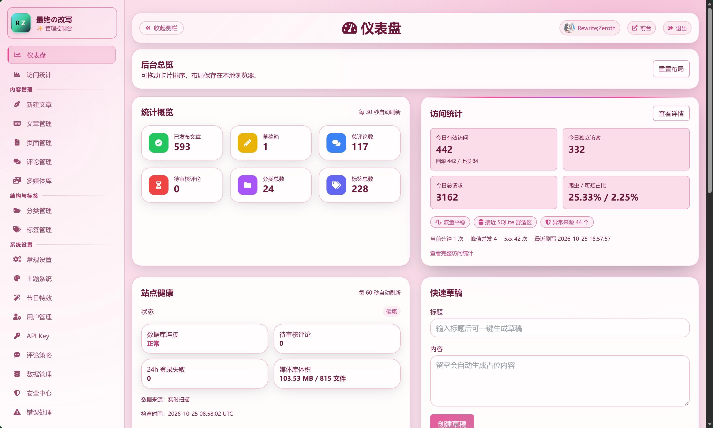

# RewrZ Project

> **Rewrite + Philosophyz = RewrZ**
> 最终的哲学，最后重写一次。

一个面向喜欢折腾、喜欢二次元、喜欢全面发展不偏科的中二病博客系统：主推**FastAPI + HTMX + SQLite**，个性、轻量、安全可控和长期可维护。

## 前端资源构建
- 项目当前使用本地 Tailwind 编译产物，不再依赖前台运行时 CDN。
- 首次参与前端样式开发前，请先执行：
```bash
npm install
npm run build:css
```
- 修改 `rewrz/templates/`、`rewrz/static/js/` 中涉及 Tailwind 类名的内容后，需重新执行：
```bash
npm run build:css
```
- 开发时可使用监听模式：
```bash
npm run watch:css
```
- 仓库会提交编译后的 CSS 产物，生产部署默认不要求安装 Node。

## 重构说明
本项目已重构完毕，正在持续更新完善中。
如果你在使用中遇到问题，欢迎提交 issue。

我曾经一度放下这个项目，回到 WordPress 系统，只想把精力留给写作本身。
但现实是，随着主流博客系统的版本、所需要的环境和依赖持续升级，维护成本并没有消失，反而部署门槛、服务器配置、服务器成本、域名成本等一直在抬升。
如果像我这样长期一直用爱发电的独立博客，最终只剩下“持续升级基础设施”这一条路，那么在越来越高的成本和0收益的情况下，“写作分享”反而会变得越来越没有动力和可笑。
另外还有一个现实问题：**后台登录入口长期暴露在自动化攻击流量下**，有限的服务器资源、带宽、个人运营维护的时间，都被大量消耗在“防守”上。
当用来“写作、记录、分享”的系统本身变成一场持续对抗，技术就开始反客为主。
于是我决定把这个旧项目重新捡起来，不追求大而全，只做真正会长期使用的能力。
这不是一次短期折腾，而是一次“最后认真重构个人博客系统”的选择。

## 项目初心
这个项目不是为了“再造一个更复杂的 CMS”，而是为了回到“写作、记录、分享”本身。

多年使用各种主流博客系统后，最深的体感不是“功能不够”，而是两种极端：
- 要么功能过重、依赖过多、维护成本越来越高；
- 要么过于极简，关键能力还得自己拼装。

RewrZ Project 的核心态度是：
- 以写作与表达为中心，而不是被工具绑架；
- 以中庸收敛替代无限堆叠；
- 以长期可维护替代短期炫技。

> 只要你用过WordPress，你就知道，你的后台登录页面，就是互联网上最繁忙的公共厕所。来自全球各个角落的IP，每分每秒都在尝试爆破你的密码。这是个不争的事实。因为WordPress太出名了，它占据了全球网站的半壁江山，所以成了所有自动化攻击脚本的默认目标。黑客们写的脚本，就是对着WordPress的wp-login.php这个裤裆猛踹。
> 这个项目的初衷，是把时间从“对抗”拿回来，重新用于写作和表达。
> 对我来说，RewrZ 是“最后一次个人网站项目”的重构尝试。

## 项目定位
RewrZ 不是“大而全 CMS”，也不是“纯静态生成器”，而是偏向用爱发电的个人网站的中间路线：以 **FastAPI + HTMX + SQLite** 为底座，把长期真正会用到的能力收进一套自己能维护的代码里。

- **后端完整可控**：账号与权限、评论、媒体库、搜索、订阅、导入导出、后台管理，基础能力不依赖插件市场补齐。
- **内容模型收敛**：`post_type` 仅 `post/page`，文章意图交给 `formats`；分类描述、标签词条释义、内容分级（通用 / 敏感 / NSFW）与 NSFW 分发隔离都在模型层有明确归属。
- **表达形态不单一**：文章、页面、微博时间线、诗词，配合详情页模板、格式内预设与 Markdown 区块指令；首页时光轴背景容器可开关。
- **动态主题贯穿全站**：前台、后台、详情页、卡片、编辑器共用一套 `--color-*` 语义变量，支持背景特效滤镜与实时预览，视觉改动不写死颜色。
- **资源与容量可控**：公开列表 / 详情缓存、浏览量内存计数批量落库、垃圾爬虫拦截、SQLite 压缩与空间预警，小体量机器即可运行。
- **数据主权**：内置 RewrZ / WordPress 导入导出，含分类描述与标签释义，迁移路径掌握在自己手里。

## 与主流博客系统对比

先说结论：RewrZ 的优势不在“生态”，而在“**更可控、更收敛、更适合长期自维护**”。

| 对比维度 | RewrZ 的优势 | WordPress/Ghost/Hexo-Hugo 的典型优势 |
|---|---|---|
| 安全基线（默认） | 后台路径隐藏、CSRF、UA 与垃圾爬虫拦截、媒体变体签名、上传与导入限制内建，减少“先装一堆安全插件” | 生态成熟，安全能力可通过大量插件与托管方案组合 |
| 内容模型治理 | `post_type` 强收敛（仅 `post/page`）+ `formats` 语义分层；分类描述、标签词条、内容分级与 NSFW 隔离统一在模型层，长期演进不易漂移 | 模型更自由、可扩展类型多，但长期演进更容易积累历史包袱 |
| 写作与编辑体验 | Markdown / 富文本双模式、版式区块、拖拽与粘贴上传、快捷保存、离开提醒、历史快照、列表内联编辑；编辑器布局按桌面与移动端分别收敛 | 编辑器生态成熟、块编辑器与配套插件丰富，第三方写作工具集成更多 |
| 主题与视觉一致性 | 动态主题变量覆盖前后台、详情、卡片与按钮，支持背景特效与实时预览；聚合页与时光轴共用骨架，差异靠主题钩子而非写死色值 | 主题与模板市场庞大，现成设计多；深度定制时需处理主题与插件的样式覆盖链 |
| 性能与容量 | 列表 / 详情缓存、浏览量批量落库、异步化数据库操作、SQLite 压缩与空间预警，面向小体量部署做保护且保留全部既有能力 | 静态方案性能极强；WP/Ghost 在成熟运维与缓存体系下也能稳定扩展 |
| 二次开发成本 | API / CRUD / Model 分层直改，业务逻辑集中，适合“自己就是维护者”的个人或团队 | 生态方案多、起步快，但深度定制可能受插件边界或框架约束 |
| 小体量部署 | 依赖链短，Python 3.12 + SQLite 起步，前端以 HTMX + 模板为主，不依赖运行时 CDN | 静态方案部署最轻；WP/Ghost 需要更完整的运行与运维体系 |
| 迁移与数据主权 | 内置 RewrZ / WordPress 导入导出，描述、释义、分级等字段随内容一起迁移 | 各有导出方案，但格式一致性与字段完整性依赖具体生态工具 |

### 什么时候优先选 RewrZ
- 你想要“可持续维护的个人系统”，而不是“功能市场型平台”。
- 你更看重架构可控、内容模型收敛和长期一致性，而不是插件数量。
- 你希望动态主题、内容分级、导入导出这些能力开箱可用，且能自己改。
- 你愿意在前期投入少量开发时间，换更加符合自己的使用习惯。
- 你觉得 RewrZ Project 很酷。

### 什么时候不建议选 RewrZ
- 你需要现成的超大插件生态和大量第三方模板市场。
- 你希望零开发介入、开箱即用地覆盖非常复杂的业务场景。
- 你需要多人协作编辑、完整工作流与成熟的团队权限体系。

## 文档导航
- 文档中心：[`docs/INDEX.md`](docs/INDEX.md)
- 使用文档：[`docs/guides/USAGE.md`](docs/guides/USAGE.md)
- 开发文档：[`docs/guides/DEVELOPMENT.md`](docs/guides/DEVELOPMENT.md)
- APP 开发指南：[`docs/architecture/API_APP.md`](docs/architecture/API_APP.md)
- 发布包生成：[`docs/operations/RELEASE.md`](docs/operations/RELEASE.md)
- 生产部署与 Nginx 加固：[`docs/operations/DEPLOYMENT.md`](docs/operations/DEPLOYMENT.md)
- 路线图（含 AI / 联邦化方向）：[`docs/planning/ROADMAP.md`](docs/planning/ROADMAP.md)

## 快速开始

> 运行环境要求 **Python 3.12 或更高版本**。

```powershell
git clone https://github.com/RewrZ/RewrZ.git
cd RewrZ
python -m venv .venv
.\.venv\Scripts\activate
pip install -r requirements.txt
.\.venv\Scripts\python.exe -m uvicorn rewrz.main:app --host 127.0.0.1 --port 8001 --reload
```

首次启动请访问安装向导：`/installer`

## 生成干净发布包

如需为 GitHub Release 生成干净 ZIP 发布包，版本号建议与 Git Tag 保持一致，例如：

```powershell
.\scripts\build_release_package.ps1 -Version v3.2
```

生成结果默认输出到 `release/`，详细说明见：

- [`docs/operations/RELEASE.md`](docs/operations/RELEASE.md)

## 界面预览

### 首页


### 微博页


### 后台登录页


### 后台管理（仪表盘）


## 开源协议
本项目使用 **AGPL-3.0**。
